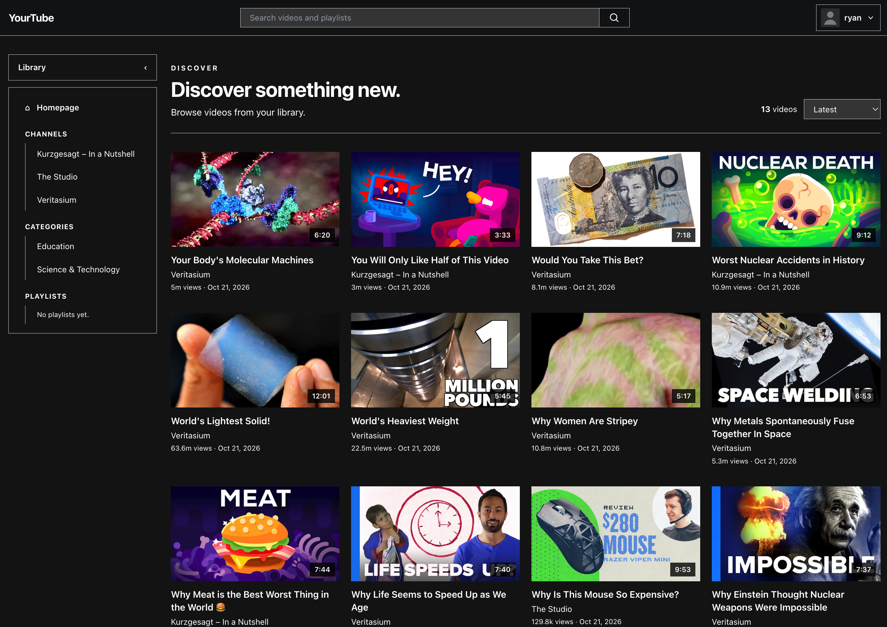
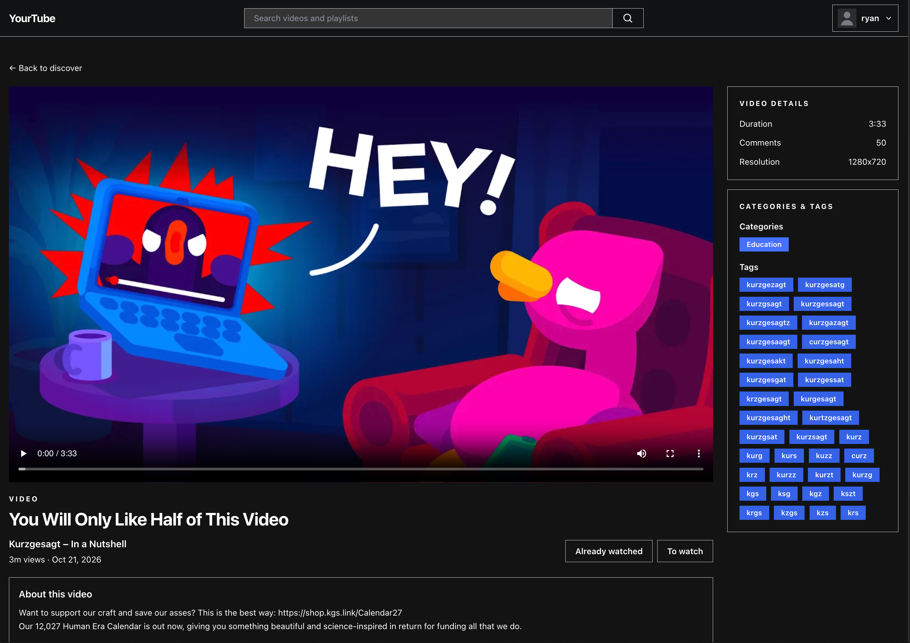
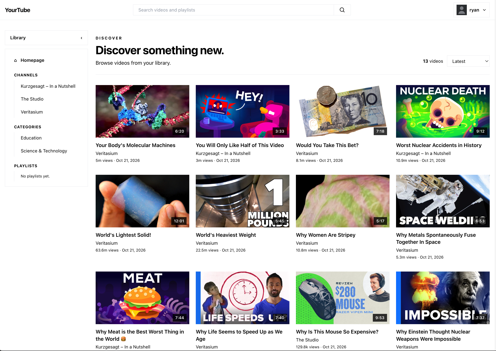

# YourTube

YourTube is a local Django app for organizing, searching, and watching your own YouTube video library. Each person runs a copy on their own computer. The database and media files stay local, so cloning the project does not include anyone's library.



## Technologies

- **Python 3.12+** and **Django 6.1** for the application and server-rendered pages
- **SQLite** for the local database
- **Pillow** for image processing, including profile pictures
- **Django templates, HTML, Tailwind CSS, and JavaScript** for the frontend

## Run YourTube locally

Requirements: Python 3.12 or newer. Internet access is needed for remote YouTube embeds and thumbnails.

From the repository directory:

```sh
python3 -m venv .venv
source .venv/bin/activate
python -m pip install --upgrade pip
python -m pip install -r requirements.txt
./bin/yourtube
```

Open <http://127.0.0.1:8081/> on the computer running YourTube and register an account. To use YourTube from another device on the same Wi-Fi/LAN, open `http://<computer-LAN-IP>:8081/` on that device (for example, `http://192.168.1.20:8081/`). Find the computer's LAN IP in its network settings. Allow inbound connections to port 8081 in the computer's firewall if prompted. Set `YOURTUBE_PORT` to another available port when running multiple web sites, for example `YOURTUBE_PORT=8082 ./bin/yourtube`.

YourTube uses the repository's `media/` folder by default. Add small demonstration videos there; an adjacent same-name image can be used as a thumbnail. To use another folder, set `DATA_ROOT` in `.env`. The launcher runs `sync_library` at startup to add new video files to the database. Django serves the app, static files, video media, and profile pictures directly. YourTube uses the browser’s native video controls.

```env
DATA_ROOT=/absolute/path/to/another/video/library
```

Set `YOURTUBE_PORT` before starting the launcher to change the port Django listens on.

## Deploy on Render

The included `render.yaml` targets Render's free web service plan and allows `yourtube.amirshygun.ir`. Add that domain to the service in the Render Dashboard and point its DNS CNAME to the `onrender.com` hostname Render assigns. Render creates the HTTPS certificate after DNS verification. The deployed app builds a fresh SQLite database and scans the repository's `media/` folder. Database changes and profile uploads use temporary storage and can disappear when Render restarts, spins down, or redeploys the service. Free services also spin down after 15 minutes without traffic and can take about a minute to start again. Large local databases and media folders are not uploaded unless committed to the repository. For persistent data, use a paid service with a persistent disk. Django serves the app and library files directly.

## Sync a media library

YourTube does not download media. Put video files under `media/` or the folder set by `DATA_ROOT`; `sync_library` scans nested folders and adds files with supported video extensions. The filename becomes the video title, categories come from the `categories` list in the adjacent `.info.json` file, and a same-name image beside the video is used as its thumbnail when present. The command adds new videos and refreshes their categories when synced again.

```text
Yourtube project/
├── manage.py
├── db.sqlite3
├── .env                          # Optional DATA_ROOT override
├── media/                        # Demo videos and optional thumbnails
└── docs/                         # screenshots and account images

Media folder/
├── Category/
│   ├── Video title.mp4
│   └── Video title.jpg            # optional thumbnail
└── Another video.webm
```

The default media directory is `media/`. Set `DATA_ROOT` in `.env` to use another existing folder. Run `python manage.py sync_library` to rescan after adding files; the local launcher runs this command automatically.



## Local data and backups

`db.sqlite3` contains local accounts, profiles, comments, and watch status. The media folder contains videos and optional thumbnails; it can be anywhere the computer running YourTube can read. Profile images are stored under `docs/account_images/` and excluded from Git. Back up the database, `docs/account_images/`, and the `DATA_ROOT` folder separately to preserve your data.

## Screenshots



## License

No license has been selected yet. Ask the project owner before redistributing this code or adding a license.
