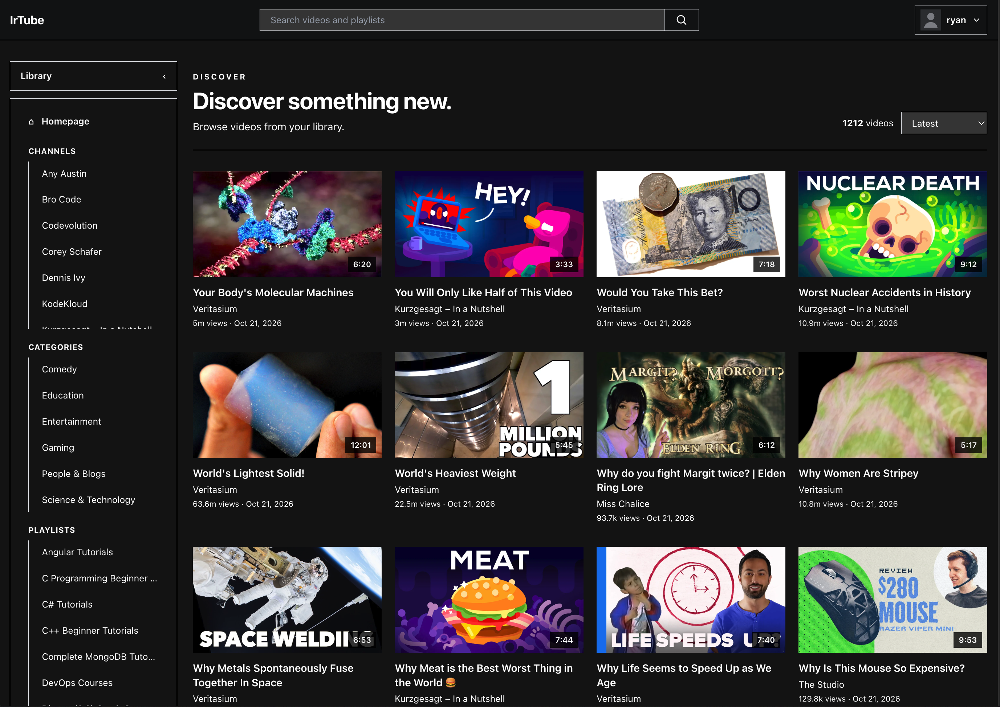
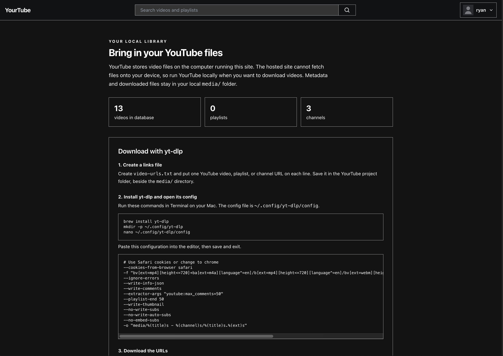
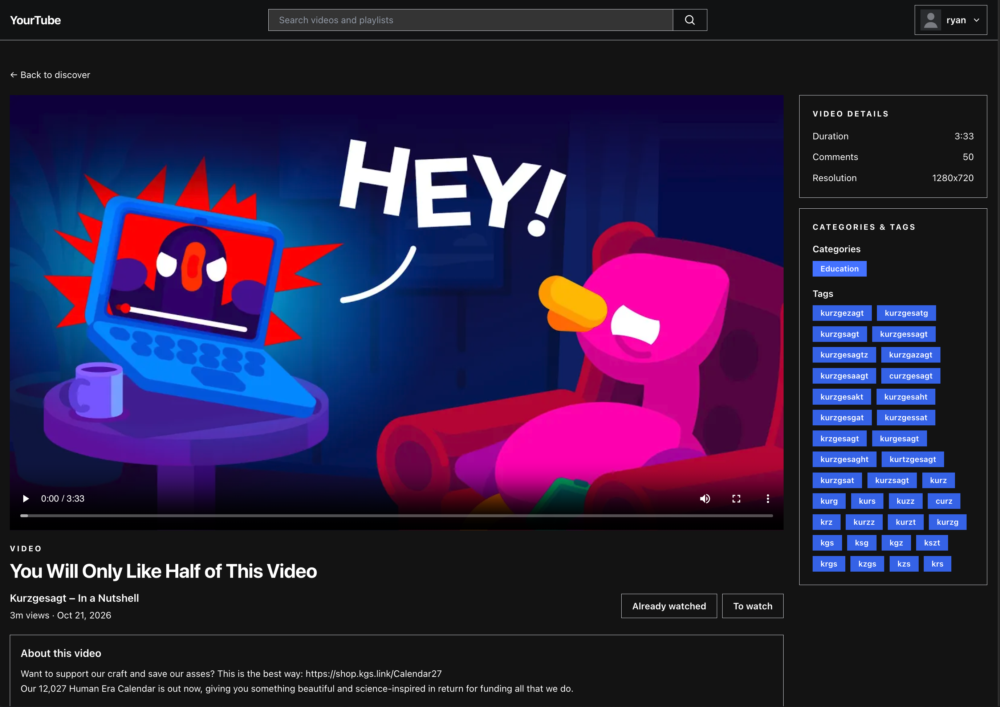
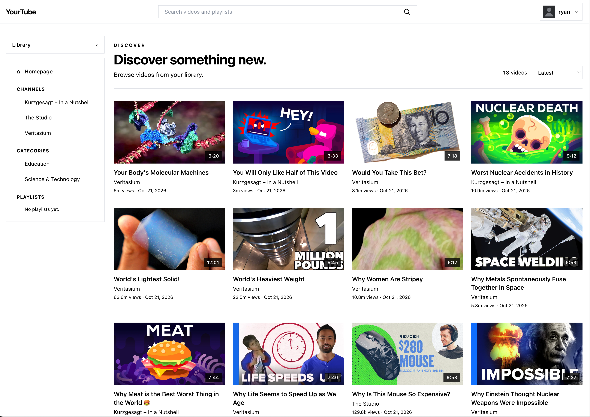

# YourTube

YourTube is a local Django app for organizing, searching, and watching your own YouTube video library. Each person runs a copy on their own computer. The database and downloaded video files stay local, so cloning the project does not include anyone's library.



## Technologies

- **Python 3.12+** and **Django 6.1** for the application and server-rendered pages
- **SQLite** for the local database
- **yt-dlp** for downloading video files and metadata
- **Pillow** for image processing, including profile pictures
- **Django templates, HTML, Tailwind CSS, and JavaScript** for the frontend

## Run YourTube locally

Requirements: Python 3.12 or newer and internet access for yt-dlp downloads and YouTube embeds.

From the repository directory:

```sh
python3 -m venv .venv
source .venv/bin/activate
python -m pip install --upgrade pip
python -m pip install -r requirements.txt
python manage.py migrate
python manage.py runserver
```

Open <http://127.0.0.1:8000/> and register an account. The first run creates the local SQLite database and `media/` directory.

## Download and import videos

YouTube video files are large, so every user downloads their own library. Run YourTube locally on the computer where you want the files stored. A hosted copy of the site cannot save downloads onto a visitor's computer.

### Download from the Import page

1. Sign in and open **Import library**.
2. Make a plain text file with one video, playlist, or channel URL on each line. Blank lines and lines beginning with `#` are ignored.
3. Enter the absolute path to a local media folder. It can be outside the repository or on an external drive, as long as the computer running YourTube can read and write it. Choose the text file and select **Download and import**. YourTube downloads videos, thumbnails, and yt-dlp info JSON files into that folder, then imports channels, playlists, videos, tags, categories, and comments into the local database.

YourTube saves the selected directory for future imports and playback. The default is the project's `media/` folder. Changing directories does not move files; importing a different directory makes the database library reflect that directory's contents.

The built-in downloader uses yt-dlp's `--write-info-json`, `--write-thumbnail`, `--convert-thumbnails jpg`, `--write-comments`, `--no-overwrites`, `--merge-output-format mp4`, and `--yes-playlist` options. It does not read the user's yt-dlp configuration file. Install yt-dlp in the same Python environment as Django; it is included in `requirements.txt`.

### Download manually with yt-dlp

You can also use yt-dlp directly. Create `video-urls.txt` with one URL per line. Install yt-dlp (for example, `brew install yt-dlp` on macOS), then create its configuration file:

```sh
mkdir -p ~/.config/yt-dlp
nano ~/.config/yt-dlp/config
```

Paste these options into the config file. The browser-cookie option is optional; use it when a video requires your browser's YouTube session, and change `safari` to a supported browser on your system.

```text
--cookies-from-browser safari
-f "bv[ext=mp4][height<=720]+ba[ext=m4a][language^=en]/b[ext=mp4][height<=720][language^=en]/bv[ext=webm][height<=720]+ba[ext=webm][language^=en]/b[ext=webm][height<=720][language^=en]"
--ignore-errors
--write-info-json
--write-comments
--extractor-args "youtube:max_comments=50"
--playlist-end 50
--write-thumbnail
--no-write-subs
--no-write-auto-subs
--no-embed-subs
-o "/absolute/path/to/your/media/%(title)s - %(channel)s/%(title)s.%(ext)s"
```

This format prefers MP4 video with M4A audio up to 720p, prefers English audio, and falls back to compatible MP4 or WebM formats. `--playlist-end 50` limits a playlist or channel URL to its first 50 entries; remove that line to download every available entry. The comment option collects up to 50 comments per video. If your browser is not Safari, edit the cookie option or remove it.

Run yt-dlp on the URL list from the project directory:

```sh
yt-dlp -a video-urls.txt
```

Replace `/absolute/path/to/your/media` with the same absolute directory path entered on the **Import library** page. When downloads finish, enter that directory in YourTube and choose **Scan folder and import**. This also works for compatible yt-dlp folders downloaded elsewhere; point YourTube at the directory containing those folders and keep each video's `.info.json`, thumbnail, and media file together.



### Expected media layout

The output template above creates a folder for each video. Keep the info JSON and thumbnail beside the matching video file. The importer scans nested folders and accepts common video and thumbnail extensions.

```text
Yourtube project/
├── manage.py
├── db.sqlite3
├── .library_media_root          # stores the selected absolute path
└── helper/data/                  # generated import data

Chosen media directory/           # default: Yourtube project/media/
├── Video title - Channel/
│   ├── Video title.mp4
│   ├── Video title.info.json
│   └── Video title.jpg
└── Another video - Channel/
    ├── Another video.webm
    ├── Another video.info.json
    └── Another video.webp
```

By default, the chosen media directory is `Yourtube project/media/`. It can instead be anywhere YourTube can read and write, such as a folder on an external drive.

Avoid renaming the sidecar files independently. Their shared filename lets the importer match metadata, thumbnail, and video. A valid `.info.json` is required for a video to be added to the database.



## Local data and backups

`db.sqlite3` contains local accounts, profiles, comments, and watch status. The selected media directory contains downloaded videos, thumbnails, and metadata; it can be anywhere on the computer running YourTube. Account profile images remain under the project's Django media folder. The database and project media folder are excluded from Git. Back up the database and selected media directory separately to preserve your library.

`helper/data/` contains generated fixture JSON used by the import helpers. The importer rebuilds it from the selected media directory. YourTube saves the chosen path in the ignored `.library_media_root` file in the project root.

## Configuration

Local development defaults to Django debug mode and accepts requests from `localhost` and `127.0.0.1`. The fallback secret is for local development only. Set `DJANGO_SECRET_KEY` to use a different secret. To turn off debug mode, set `DJANGO_DEBUG=false` and configure `DJANGO_ALLOWED_HOSTS` as a comma-separated list.

These instructions are for local use. A public deployment needs separate configuration for secrets, allowed hosts, HTTPS, static and media storage, and upload limits.

## Deploy on Render

The included `render.yaml` defines a single-instance Django web service with a 10 GB persistent disk. The service uses SQLite on that disk for the database and stores downloaded videos, thumbnails, import state, and profile images there. Render requires a paid web service for persistent disks; the disk is only available to that one service instance. Video downloads can quickly fill 10 GB, so increase the disk size in Render before importing a large library. Render runs the downloader on the server, and downloaded files are not saved to visitors' computers.

To deploy, push this repository to a Git provider supported by Render, then in the Render Dashboard choose **New > Blueprint**, connect the repository, and apply the `render.yaml` blueprint. Render generates the Django secret, collects static files during the build, and applies database migrations when the service starts. Once the deploy is live, open the service URL and register an account.

The persistent disk keeps the database and media across deploys. Back up the database and media separately if you need to preserve the library beyond the lifetime of the Render service.

## Screenshots



## License

No license has been selected yet. Ask the project owner before redistributing this code or adding a license.
