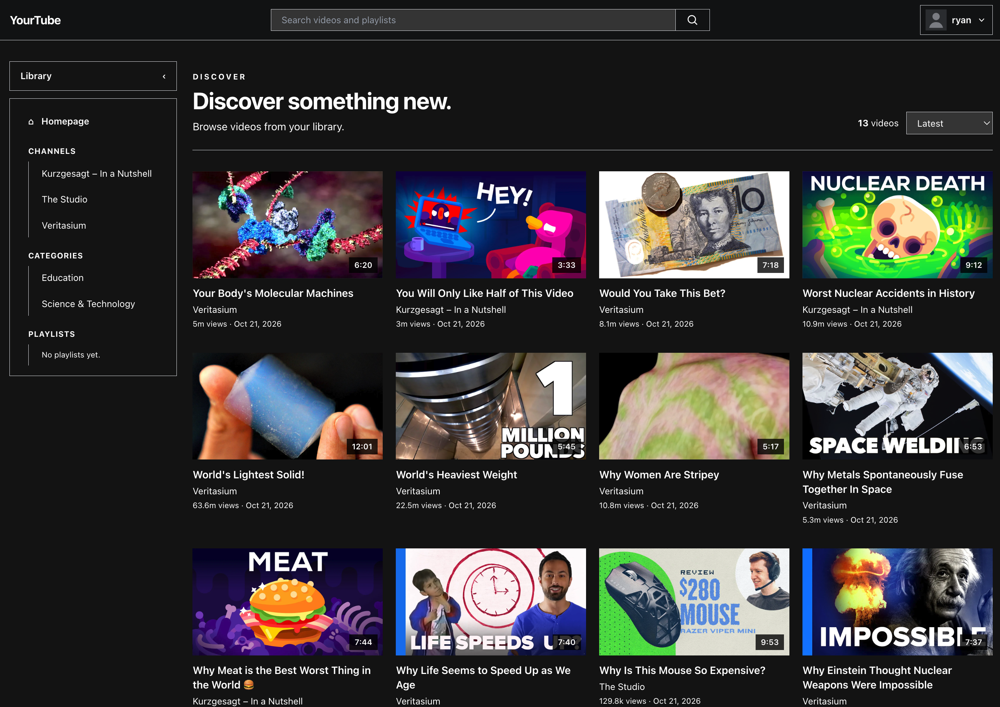

# YourTube

YourTube is a local Django app for organizing, searching, and watching your own YouTube video library. Each person runs a copy on their own computer. The database and media files stay local, so cloning the project does not include anyone's library.



## Technologies

- **Python 3.12+** and **Django 6.1** for the application and server-rendered pages
- **SQLite** for the local database
- **Pillow** for image processing, including profile pictures
- **Django templates, HTML, Tailwind CSS, and JavaScript** for the frontend

## Run YourTube locally

Requirements: Python 3.12 or newer. Internet access is needed for remote YouTube embeds and thumbnails.

From the repository directory:

```sh
python3 -m venv .venv
source .venv/bin/activate
python -m pip install --upgrade pip
python -m pip install -r requirements.txt
python manage.py migrate
python manage.py runserver
```

Open <http://127.0.0.1:8000/> and register an account. The import page asks you to choose an existing media folder; YourTube does not create a video-library folder in the repository.

## Import a media library

YourTube does not download media itself. Open **Import library** and use **Browse folders** to choose an existing folder on this computer; the selected path is saved for playback and future refreshes. Follow the yt-dlp command shown on that page to download videos into the folder, then click **Scan folder and refresh database**. Scanning cleans yt-dlp `.info.json` sidecars before updating the database. It does not move or delete video files.

The importer scans nested folders for `.info.json` metadata files and updates videos, channels, playlists, tags, categories, and comments in the database. It matches each metadata file with video and thumbnail files that share its basename. Rerunning the import updates matching records and removes database videos whose metadata is no longer in the selected folder.

### Expected media layout

Keep each `.info.json` metadata file beside its matching video and thumbnail. The importer scans nested folders and accepts common video and thumbnail extensions. Metadata should use the yt-dlp `.info.json` format; YourTube only reads these files and does not create them.

```text
Yourtube project/
├── manage.py
├── db.sqlite3
├── docs/                         # screenshots, account images, and import logs
└── .library_media_root           # stores your selected absolute media path

Chosen media directory/           # chosen by the user; may be outside the project
├── Video title - Channel/
│   ├── Video title.mp4
│   ├── Video title.info.json
│   └── Video title.jpg
└── Another video - Channel/
    ├── Another video.webm
    ├── Another video.info.json
    └── Another video.webp
```

There is no default media directory. Choose an existing folder that YourTube can read, such as a folder on an external drive.

Avoid renaming the sidecar files independently. Their shared filename lets the importer match metadata, thumbnail, and video. A valid `.info.json` is required for a video to be added to the database.


## Local data and backups

`db.sqlite3` contains local accounts, profiles, comments, and watch status. The selected media directory contains existing videos, thumbnails, and metadata; it can be anywhere the computer running YourTube can read. Profile images and import logs are stored under `docs/`; the account images and import logs are excluded from Git. Back up the database, `docs/account_images/`, and selected media directory separately to preserve your data.

YourTube saves the chosen path in the ignored `.library_media_root` file in the project root.

## Screenshots


## License

No license has been selected yet. Ask the project owner before redistributing this code or adding a license.
